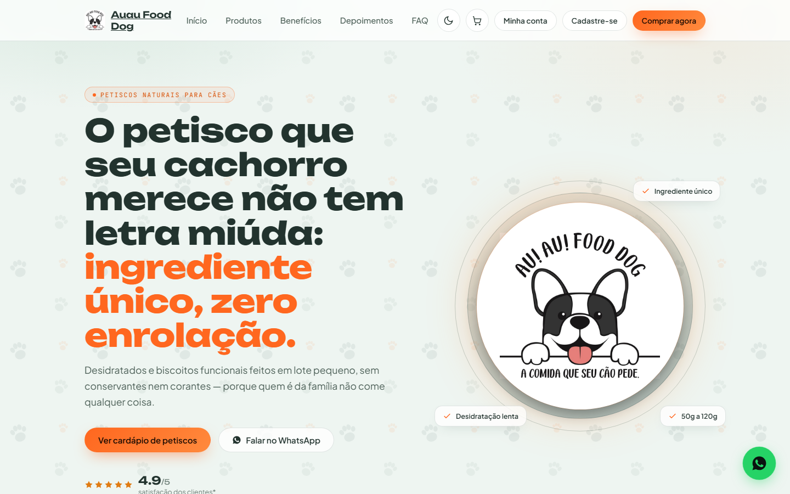
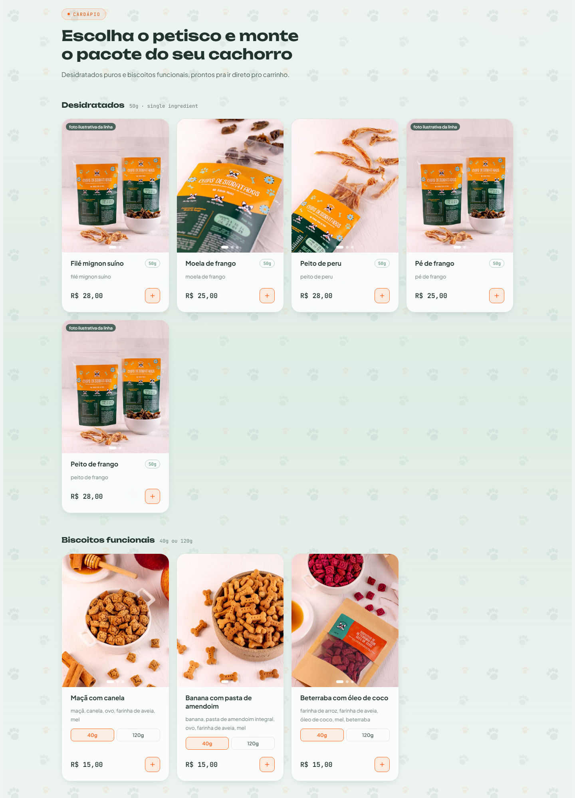
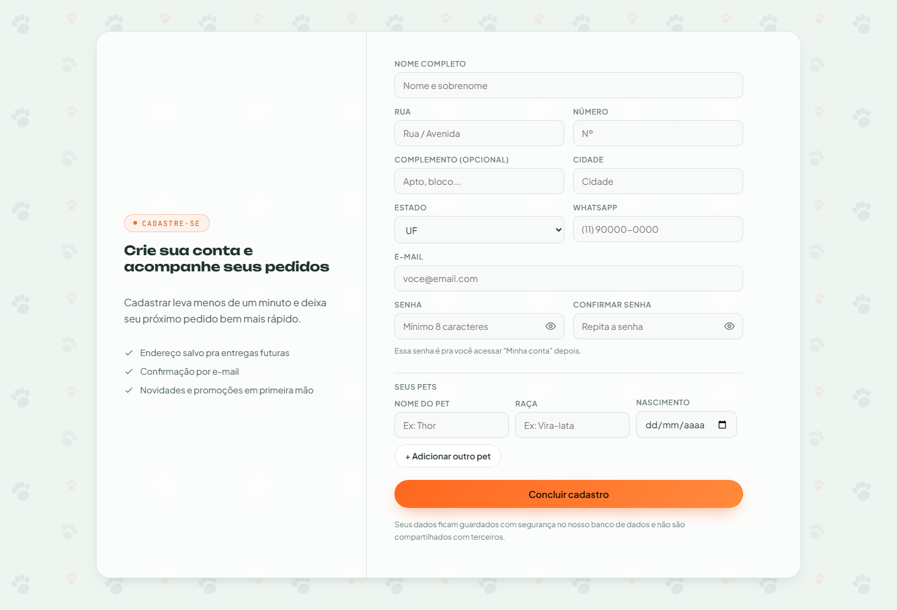
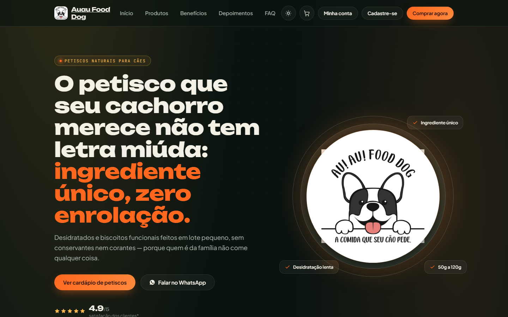
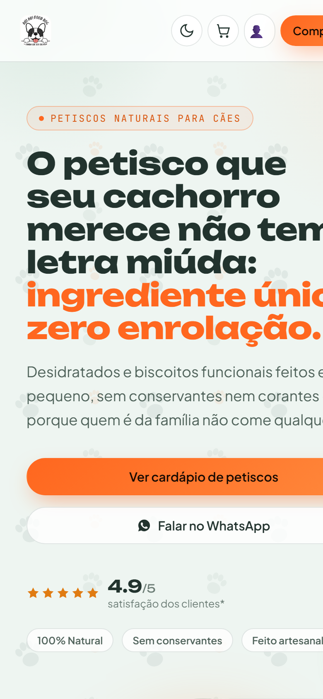
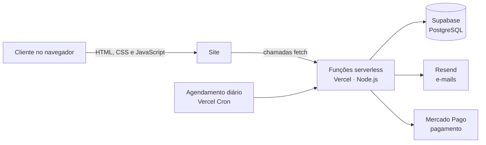

# Au Au Food Dog: loja virtual em produção, construída com IA

> Loja virtual de petiscos naturais para cães, **no ar e com clientes reais**.
> Desenvolvida do zero com **Claude Code** (desenvolvimento assistido por IA), a partir de requisitos escritos em linguagem natural.

🔗 **Site:** [auaufooddog.vercel.app](https://auaufooddog.vercel.app)

---

## O problema

A Au Au Food Dog é uma marca pequena de petiscos naturais para cães. Todas as vendas aconteciam pelo WhatsApp e pelo Instagram: o cliente perguntava preço, montava o pedido na conversa e passava o endereço toda vez. Não havia cadastro de clientes, nem uma forma de oferecer cupons, nem de saber quem tinha desistido de uma compra.

**Objetivo:** ter uma loja própria, barata de manter, que:

- organize o cardápio e o carrinho;
- guarde o cadastro do cliente (e dos pets dele);
- permita criar cupons de desconto;
- recupere carrinhos abandonados;
- continue fechando a venda pelo WhatsApp enquanto o pagamento online não é ativado.

## O que a loja faz

| Para o cliente | Para a dona da loja (painel admin) |
| --- | --- |
| Cardápio com galeria de fotos por produto | Lista de clientes cadastrados, com os pets |
| Carrinho que fica salvo no navegador | Criação e exclusão de cupons (% ou valor fixo) |
| Cadastro com endereço, pets e senha | Lista de carrinhos abandonados, com botão que abre o WhatsApp com a mensagem pronta |
| Área "Minha conta": ver e editar dados e pets | Exclusão de clientes |
| Cupom de desconto no carrinho | Acesso protegido por senha |
| "Esqueci minha senha" com link por e-mail | |
| Modo claro e modo escuro | |
| Fechamento do pedido pelo WhatsApp (pagamento online em integração) | |

  
  

  
  

## Arquitetura

- **Front-end:** uma página em HTML, CSS e JavaScript puro, sem framework.
- **Back-end:** funções serverless em Node.js na Vercel (plano gratuito).
- **Banco de dados:** Supabase (PostgreSQL), com as tabelas de clientes, pedidos, cupons, usos de cupom e carrinhos abandonados.
- **E-mail:** Resend (confirmação de cadastro, lembrete de carrinho, recuperação de senha).
- **Pagamento:** Mercado Pago Checkout Pro (código pronto, aguardando a conta da loja).
- **Rotina diária:** um cron da Vercel verifica os carrinhos abandonados e dispara os lembretes.

## Decisões técnicas que valem destacar

- **Cupom de uso único garantido pelo banco, não pelo código.** A regra "1 uso por cliente por cupom" é uma restrição `UNIQUE` no PostgreSQL. Mesmo que o cliente clique várias vezes ao mesmo tempo, o banco só aceita um uso.
- **O desconto é sempre recalculado no servidor.** O valor que vem do navegador nunca é usado; o servidor busca o cupom na tabela e calcula de novo antes de montar o pagamento.
- **Cupom só para cliente logado.** Assim a identidade é verificada e ninguém usa o mesmo cupom digitando outro e-mail.
- **Senhas com hash scrypt e sessões em cookie assinado (HMAC).** O cliente fica logado por até 400 dias, e o cookie do painel admin é `HttpOnly`.
- **Recuperação de senha segura.** O banco guarda só o hash do token, que expira em 1 hora, com limite de um pedido por minuto.
- **Dentro do limite do plano gratuito.** A Vercel gratuita permite 12 funções por projeto; os endpoints foram agrupados por assunto (`conta`, `admin`), com um parâmetro de ação.
- **Carrinho abandonado em duas etapas.** O e-mail sai automaticamente no 3º e no 5º dia. O WhatsApp é semiautomático, por escolha da dona da loja: o painel deixa a mensagem pronta e ela decide quando enviar.
- **Descadastro de marketing** com link individual em cada e-mail.

## Como foi construído

O projeto foi desenvolvido com o **Claude Code**, em conversas em português:

1. **Eu definia o requisito e a regra de negócio.** Exemplo: "o cupom só pode ser usado uma vez por cliente".
2. **O Claude Code propunha a solução e escrevia o código.**
3. **Eu testava no site real**, de ponta a ponta: cadastro, login, carrinho, cupom e painel.
4. **Ajustávamos até funcionar**, inclusive corrigindo bugs que só apareceram em produção.

Meu papel foi o de **dono do produto e responsável pelos testes**: entender o negócio, transformar necessidades em requisitos claros, decidir os trade-offs (por exemplo, WhatsApp semiautomático em vez de automático) e validar cada entrega com usuários reais.

## Status

- ✅ No ar, com clientes reais cadastrados
- ✅ Cadastro, login, "Minha conta", cupons, painel admin e carrinho abandonado funcionando
- 🔄 Pagamento online (Mercado Pago): código pronto, aguardando a conta da loja
- 🔄 Domínio próprio e e-mail com domínio verificado

## Sobre o código

Como a loja está em produção com dados de clientes reais, o código-fonte fica em um **repositório privado**. Posso apresentá-lo em uma entrevista.

---

**Carlos Eduardo Furtuoso**: Especialista em Automação com IA
[LinkedIn](https://www.linkedin.com/in/carlos-furtuoso-a60904158) · [GitHub](https://github.com/carlosfurtuoso)
